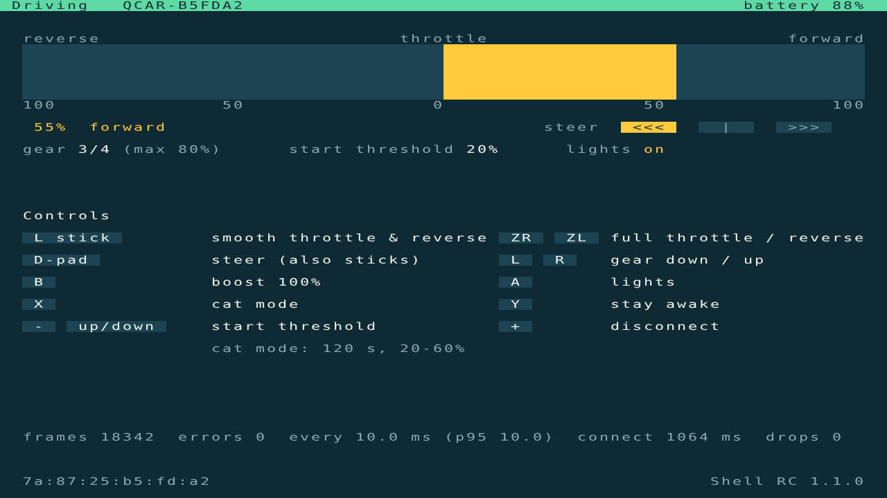
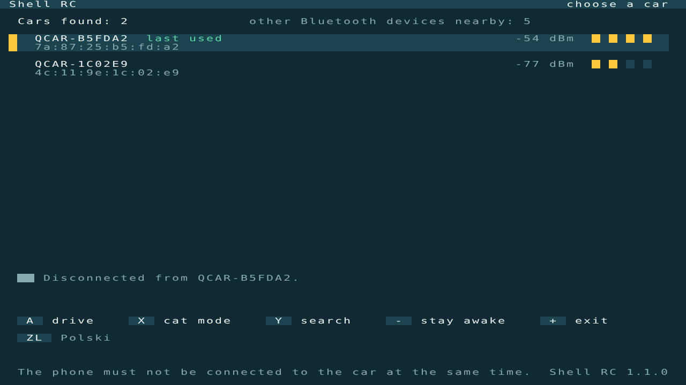

# Shell RC

**English** | [Polski](README.pl.md)

Drive the toy cars from Shell's promotions (the removable "battery" with a Bluetooth module)
from a **Nintendo Switch**, or let **Home Assistant** send them around the room for your cat.
No phone and no extra hardware needed.



**Download:** the **Releases** tab (`shellrc.nro` for the Switch, `shell_rc-ha.zip` for Home
Assistant). Changes: [CHANGELOG.md](CHANGELOG.md).

## Which cars?

| series | status |
|---|---|
| **Marvel 2026** (Poland, USB-C module, `QCAR-…`) | ✅ tested |
| Shell Motorsport 2020–2023 (`QCAR-…`) | ❔ same protocol, should work; untested |
| Shell Racing Legends 2024+ (`SL-…`) | ❌ different protocol, not supported |

Got a different car? Report it (the "Other car / module" template): [CONTRIBUTING.md](CONTRIBUTING.md).

## Switch

Needs a Switch running homebrew (Atmosphère). Tested on HOS 20.5.0 with Atmosphère 1.10.0.

1. Copy `shellrc.nro` to the SD card as `/switch/shellrc/shellrc.nro`.
2. Start hbmenu **in application mode**: hold R while launching any game.
3. Switch the car on. A phone must not be connected to it at the same time.
4. Pick **Shell RC**, then the car from the list. Next time it connects on its own.

| button | action |
|---|---|
| left stick up/down | throttle and reverse, smooth |
| ZR / ZL | full throttle / full reverse (up to the gear limit) |
| D-pad or stick sideways | steer |
| L / R | gear: limit 40 / 60 / 80 / 100% |
| B (hold) | boost 100% |
| A | lights |
| X | cat mode: the car drives by itself, randomly and slowly |
| `-` + up/down | start threshold (default 20%) |
| Y | standby (the Switch stays awake) |
| `+` | disconnect |
| ZL (on the car list) | language: English / Polish |

The throttle gauge has zero in the middle: forward grows to the right, reverse to the left,
the same way you push the stick. The color of the top band is the connection state.

The car stops when you press HOME, put the Switch to sleep, detach the controller or lose the
connection, and stays stopped until you release the throttle. The module itself stops the
car after ~0.4 s without a signal.

Settings, HTTP API and troubleshooting: [docs/switch.md](docs/switch.md).



## Home Assistant

The `shell_rc` integration connects to the car over Home Assistant's Bluetooth, no Switch
involved. Unzip `shell_rc-ha.zip` into `/config/custom_components/`, restart HA, and the car
shows up as a discovered device.

You get a **Cat mode** switch (duration and speed range), **Stop**, **Battery** (checked
every 30 min), **Visible** and **Last seen**. Details, HACS and example automations (a
vibration sensor on the scratching post starts the car):
[docs/home-assistant.md](docs/home-assistant.md).

The module accepts one connection at a time: while you drive with the Switch, HA waits.

## Building

Only Docker is required.

```sh
make test                          # tests: C core + HA integration
make nx                            # nx/shellrc.nro
make deploy SWITCH_IP=192.168.x.y  # send to the Switch (hbmenu: Y), live log in the terminal
make deploy-ha HA=192.168.x.y      # copy the integration to HA OS over SSH and restart HA
make ui-preview                    # Switch screens rendered as PNG
make release                       # dist/shellrc.nro + dist/shell_rc-ha.zip
```

GitHub Actions build and test everything on every push. Publishing a release with a `v*`
tag attaches the built files to it.

```
nx/                          Switch app (C, libnx): BLE, 10 ms sender thread, UI
core/                        portable C: AES, frames, controller mapping, cat mode, steering assist
custom_components/shell_rc/  Home Assistant integration (Python)
tests-c/, tests-ha/          tests (C core; integration on a real HA with a fake car)
tools/ui-preview/            renders the Switch screens to PNG
docs/                        protocol, Switch, Home Assistant, measurements
research/                    diagnostic tools (BLE scanner for the Switch, recording analysis)
```

How the protocol works (AES-128, frames, watchdog, battery): [docs/protocol.md](docs/protocol.md).
Measurements and design decisions (Polish only): [docs/research/](docs/research/).

## Authors

- **tomeoeo**: idea, hardware testing (Switch, Marvel module, Home Assistant), measurements,
  design decisions.
- **Claude** (Anthropic): code and documentation.

The QCAR protocol family was worked out earlier by the authors of
[scrool's gist](https://gist.github.com/scrool/e79d6a4cb50c26499746f4fe473b3768),
[Gadgetbridge](https://codeberg.org/Freeyourgadget/Gadgetbridge) and
[jenkings/BLE-RC-Car-ESP32](https://github.com/jenkings/BLE-RC-Car-ESP32). This project
builds on their findings.

## License

[MIT](LICENSE). Not affiliated with Shell, BrandBase or Nintendo. Names belong to their
respective owners.
