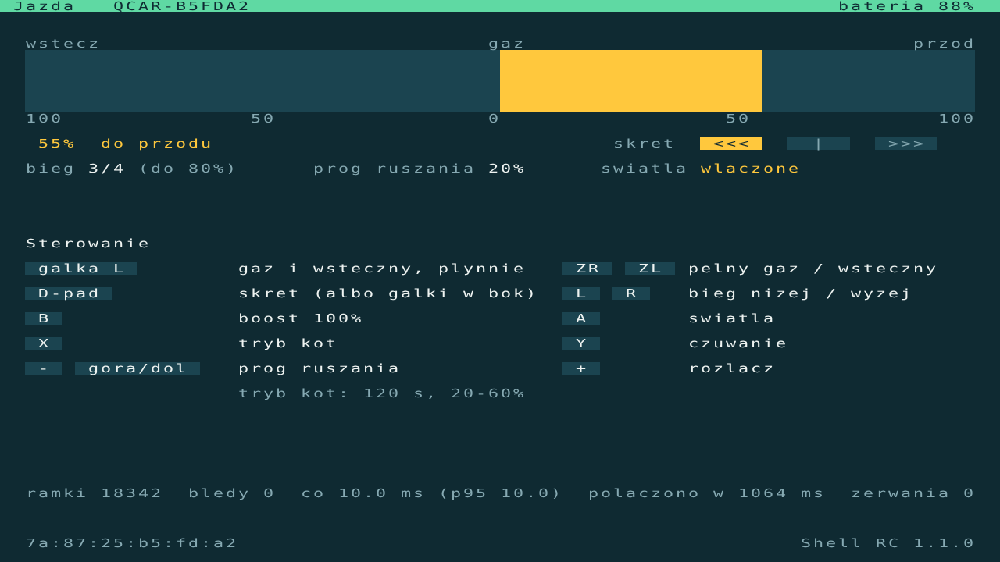
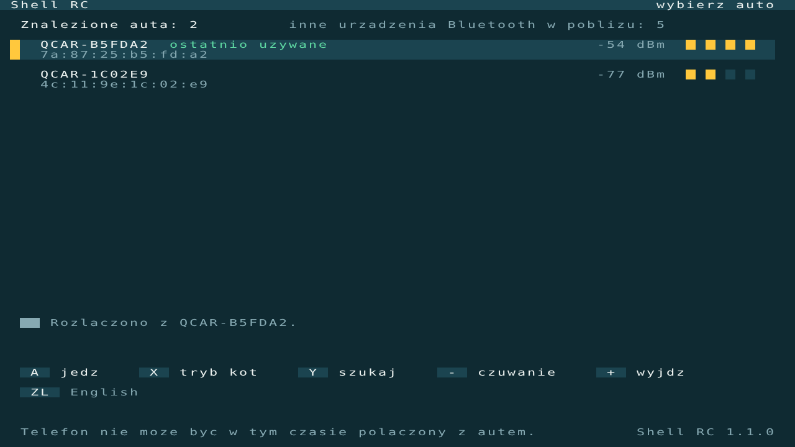

# Shell RC

[English](README.md) | **Polski**

Steruj autkami z promocji Shell (wyjmowana „bateria” z modułem Bluetooth) z **Nintendo
Switcha**, albo puszczaj je samopas po pokoju dla kota z **Home Assistanta**. Bez telefonu
i bez dodatkowego sprzętu.



**Pobierz:** zakładka **Releases** (`shellrc.nro` dla Switcha, `shell_rc-ha.zip` dla Home
Assistanta). Zmiany: [CHANGELOG.md](CHANGELOG.md).

## Które auta?

| seria | stan |
|---|---|
| **Marvel 2026** (Polska, moduł z USB-C, `QCAR-…`) | ✅ przetestowane |
| Shell Motorsport 2020–2023 (`QCAR-…`) | ❔ ten sam protokół, powinno działać; nie testowane |
| Shell Racing Legends 2024+ (`SL-…`) | ❌ inny protokół, nieobsługiwane |

Masz inne auto? Zgłoś je (szablon „Inne auto / moduł”): [CONTRIBUTING.md](CONTRIBUTING.md).

## Switch

Wymaga Switcha z homebrew (Atmosphère). Przetestowane na HOS 20.5.0 i Atmosphère 1.10.0.

1. Skopiuj `shellrc.nro` na kartę SD do `/switch/shellrc/shellrc.nro`.
2. Uruchom hbmenu **w trybie aplikacji**: przytrzymaj R przy starcie dowolnej gry.
3. Włącz auto. Telefon nie może być w tym czasie z nim połączony.
4. Wybierz **Shell RC** i auto z listy. Następnym razem połączy się samo.

| przycisk | działanie |
|---|---|
| lewa gałka góra/dół | gaz i wsteczny, płynnie |
| ZR / ZL | pełny gaz / pełny wsteczny (do limitu biegu) |
| D-pad albo gałka w bok | skręt |
| L / R | bieg: limit 40 / 60 / 80 / 100% |
| B (trzymaj) | boost 100% |
| A | światła |
| X | tryb kot: auto jeździ samo, losowo i wolno |
| `-` + góra/dół | próg ruszania (domyślnie 20%) |
| Y | czuwanie (Switch nie zasypia) |
| `+` | rozłącz |
| ZL (na liście aut) | język: polski / angielski |

Wskaźnik gazu ma zero pośrodku: w prawo rośnie jazda do przodu, w lewo wsteczny, tak jak
wychylasz gałkę. Kolor górnego paska to stan połączenia.

Auto staje, gdy naciśniesz HOME, uśpisz Switcha, odepniesz pada albo zerwie się połączenie,
i stoi, dopóki nie puścisz gazu. Moduł sam zatrzymuje auto po ~0,4 s bez sygnału.

Ustawienia, API HTTP i rozwiązywanie problemów: [docs/switch.pl.md](docs/switch.pl.md).



## Home Assistant

Integracja `shell_rc` łączy się z autem przez Bluetooth Home Assistanta, bez Switcha.
Rozpakuj `shell_rc-ha.zip` do `/config/custom_components/`, zrestartuj HA, a auto pojawi się
jako wykryte urządzenie.

Dostajesz przełącznik **Tryb kot** (czas i zakres prędkości), **Stop**, **baterię**
(sprawdzaną co 30 min) oraz **Widoczne** i **Ostatnio widziane**. Szczegóły, HACS
i przykładowe automatyzacje (czujnik drgań na drapaku uruchamia auto):
[docs/home-assistant.pl.md](docs/home-assistant.pl.md).

Moduł przyjmuje jedno połączenie naraz: kiedy jeździsz Switchem, HA czeka.

## Budowanie

Wymaga tylko Dockera.

```sh
make test                          # testy: rdzeń w C + integracja HA
make nx                            # nx/shellrc.nro
make deploy SWITCH_IP=192.168.x.y  # wyślij na Switcha (hbmenu: Y), log na żywo w terminalu
make deploy-ha HA=192.168.x.y      # wgraj integrację na HA OS przez SSH i zrestartuj HA
make ui-preview                    # podgląd ekranów Switcha jako PNG
make release                       # dist/shellrc.nro + dist/shell_rc-ha.zip
```

GitHub Actions budują i testują wszystko przy każdym pushu. Opublikowanie wydania z tagiem
`v*` dołącza do niego gotowe pliki.

```
nx/                          aplikacja na Switcha (C, libnx): BLE, wątek 10 ms, UI
core/                        przenośne C: AES, ramki, mapowanie pada, tryb kot, pomoc przy skręcie
custom_components/shell_rc/  integracja Home Assistant (Python)
tests-c/, tests-ha/          testy (rdzeń w C; integracja na prawdziwym HA z udawanym autem)
tools/ui-preview/            render ekranów Switcha do PNG
docs/                        protokół, Switch, Home Assistant, wyniki pomiarów
research/                    narzędzia diagnostyczne (skaner BLE dla Switcha, analiza nagrań)
```

Jak działa protokół (AES-128, ramki, watchdog, bateria): [docs/protocol.pl.md](docs/protocol.pl.md).
Pomiary i decyzje projektowe (po polsku): [docs/research/](docs/research/).

## Autorzy

- **tomeoeo**: pomysł, testy na sprzęcie (Switch, moduł Marvel, Home Assistant), pomiary,
  decyzje projektowe.
- **Claude** (Anthropic): kod i dokumentacja.

Protokół rodziny QCAR rozpracowali wcześniej autorzy
[gista scrool](https://gist.github.com/scrool/e79d6a4cb50c26499746f4fe473b3768),
[Gadgetbridge](https://codeberg.org/Freeyourgadget/Gadgetbridge) i
[jenkings/BLE-RC-Car-ESP32](https://github.com/jenkings/BLE-RC-Car-ESP32). Ten projekt
korzysta z ich ustaleń.

## Licencja

[MIT](LICENSE). Projekt nie jest powiązany z Shell, BrandBase ani Nintendo. Nazwy należą do
ich właścicieli.
